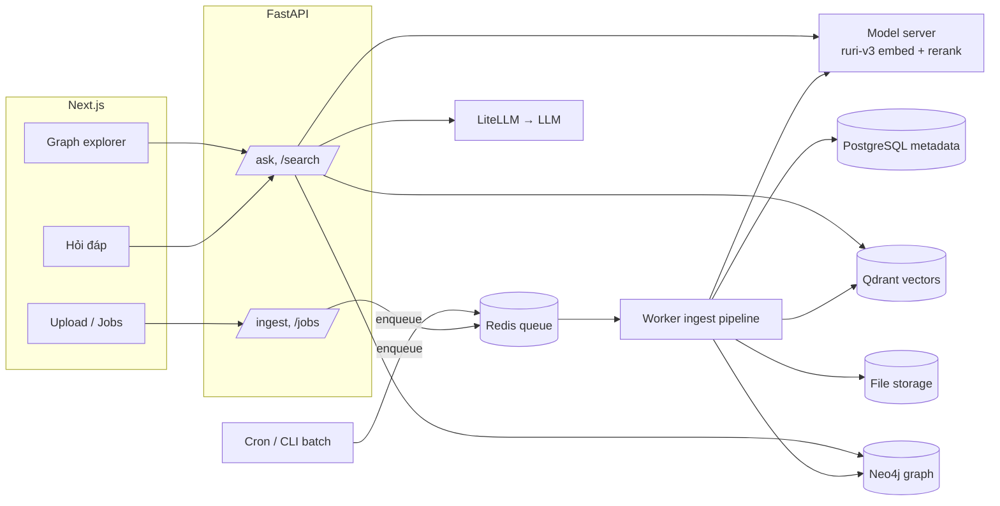

# GraphRAG cho văn bản pháp luật Nhật Bản – Tech Stack & Kiến trúc (v0.3)

> Mục tiêu: app 2 phần **Ingest** và **Retrieval**, retrieval = **Dense (vector) + Graph**, bắt đầu đơn giản rồi mở rộng dần.
> Tài liệu tham chiếu: "#19 - GraphRAG - Từ văn bản tới Knowledge Graph" (Microsoft GraphRAG 3.1.1, BGE-M3, LanceDB, Graph + RRF).
>
> **Changelog v0.3 (2026-10-07)** – bắt đầu code P0 (`jp-legal-graphrag/`):
> - On-prem: **mỗi service 1 Dockerfile** (`web`, `api`, `worker`, `model-server`), `docker-compose.yml` gọi các service; frontend Next.js **static export chạy trên Nginx** (Nginx proxy `/api` → FastAPI, SSE không buffer). Override GPU (`docker-compose.gpu.yml`) và dev (`docker-compose.dev.yml`).
> - Cấu hình qua **biến môi trường** (`.env`), bỏ `settings.yaml`. Base image / PyPI / npm / HF mirror đều override được cho mạng nội bộ; hỗ trợ air-gapped (`PRELOAD_MODELS`, `HF_HUB_OFFLINE`, `./data/import`).
> - ID: article `uid = {law_id}#{article_key}` (vd. `322AC0000000049#32_2`), chunk `{uid}~{part}`. Nạp lại 1 luật = thay thế phiên bản hiện tại. PostgreSQL bảng `legal_refs` là nguồn gốc của các cạnh dẫn chiếu; Neo4j được dựng lại từ đó (`rebuild-links`).
> - **Fusion đổi từ RRF sang "slots"** sau khi đo thực tế trên 20 câu hỏi (mục 6): RRF làm Recall@1 tụt 0.72 → 0.05.
>
> **Changelog v0.2 (2026-10-07)** – theo quyết định của anh Dan:
> - Frontend: **Next.js 16.x (App Router)** thay cho Streamlit.
> - Lưu trữ: **Qdrant (vector) + Neo4j (graph)** thay cho Neo4j-only.
> - Model: **cl-nagoya/ruri-v3-310m** (embedding) + **cl-nagoya/ruri-v3-reranker-310m** (rerank), cùng họ Ruri v3.
> - Ingest: 2 chế độ **Batch (CLI/cron)** và **Upload file (UI → job queue → worker)**.
> - Nguồn e-Gov: initial load bằng **XML一括ダウンロード**, cập nhật bằng API + rate limit tự áp.

---

## 1. Rút ra gì từ tài liệu #19

| Điểm trong tài liệu | Áp dụng cho dự án |
|---|---|
| MS GraphRAG: chunk 600 token → LLM trích entity/relationship → Leiden community → community report → embedding | Pipeline đầy đủ nhưng **tốn LLM**, output khó kiểm soát. Không dùng làm lõi ở MVP. |
| Cảnh báo: entity/relationship do LLM sinh ra **chưa được xác minh** | Luật Nhật có cấu trúc + dẫn chiếu tường minh → dựng graph **xác định (deterministic)** từ XML trước, LLM để sau. |
| Graph + RRF (k=60, w_dense=1.0, w_graph=0.5): Recall@5 0.75 → 0.82, nhưng Recall@1/MRR giảm | Dense là nhánh chính, Graph bổ sung, fuse **weighted RRF**, rồi **rerank** để kéo lại MRR. |
| Cần bộ câu hỏi + nhãn để đo Recall@k, MRR, nDCG | Xây bộ eval 30–50 câu **ngay từ P0**. |

### MS GraphRAG vs Neo4j
- **Microsoft GraphRAG** = *framework/pipeline* (indexing bằng LLM + các phương thức query local/global/drift). Output là Parquet + LanceDB, không phải graph DB.
- **Neo4j** = *graph database* (lưu node/cạnh, truy vấn Cypher, traversal nhiều bước, visualize).
- Không cùng loại → có thể kết hợp: dùng ý tưởng/pipeline của MS GraphRAG (phase 3: community + report), lưu kết quả vào Neo4j.
- Dự án này: **tự viết pipeline** (nhẹ, kiểm soát được, khai thác cấu trúc luật) + **Neo4j làm graph store**.

---

## 2. Tech Stack

| Lớp | Lựa chọn | Ghi chú |
|---|---|---|
| Frontend | **Next.js 16.x** (App Router, TypeScript), Tailwind + shadcn/ui, `react-force-graph` / Cytoscape.js để hiển thị subgraph | Trang: Hỏi đáp, Upload, Jobs, Laws/Graph explorer. Streaming câu trả lời qua SSE. |
| Backend API | **Python 3.12 + FastAPI**, Pydantic v2, quản lý bằng **uv** | `/ingest/*`, `/jobs/*`, `/search`, `/ask` (SSE). |
| Job queue | **Redis + arq** (async worker) | Ingest chạy nền, có trạng thái job, retry. Có thể đổi sang Celery khi cần. |
| Metadata DB | **PostgreSQL** | Bảng `documents` (hash, nguồn, trạng thái), `ingest_jobs`, `law_versions`. Nguồn sự thật để đồng bộ Qdrant ↔ Neo4j. |
| File storage | Local volume (MVP) → **MinIO/S3** sau | Lưu file upload gốc + XML thô từ e-Gov. |
| Vector DB | **Qdrant** | Collection `articles`: dense vector 768-d (cosine) + payload (`law_id`, `article_key`, `revision_id`, `law_type`, `enforcement_date`…) để filter. Phase 1 thêm **sparse vector** (BM25 tiếng Nhật, token bằng Sudachi) ngay trong Qdrant. |
| Graph DB | **Neo4j 5.x Community** | Chỉ lưu cấu trúc + dẫn chiếu (không lưu embedding). |
| Model server | FastAPI + `sentence-transformers` (1 service, load 2 model) | `/v1/embeddings` (OpenAI-compatible) + `/v1/rerank`. |
| Embedding | **cl-nagoya/ruri-v3-310m** | 768-d, tối đa 8192 token; prefix `検索クエリ: ` (query) / `検索文書: ` (document). |
| Reranker | **cl-nagoya/ruri-v3-reranker-310m** | CrossEncoder, 8192 token, cùng base Ruri v3 / ModernBERT-Ja. |
| LLM | **LiteLLM** (SDK, sau có thể chạy proxy) → OpenRouter / OpenAI / Anthropic / Gemini | Chỉ dùng sinh câu trả lời ở MVP. |
| Parse | `lxml` (e-Gov XML), `PyMuPDF` (PDF), `python-docx` (DOCX) | |
| Chuẩn hoá JP | NFKC có chọn lọc, `kanji_num` tự viết, SudachiPy (phase 1) | |
| Eval | Script tự viết (Recall@k, MRR@10, nDCG@10), sau thêm Ragas | |
| Observability | Logging JSON (MVP), Langfuse (phase sau) | |
| Hạ tầng | **Docker Compose**: `web`, `api`, `worker`, `model-server`, `qdrant`, `neo4j`, `postgres`, `redis` | GPU cho `model-server` nếu có. |

### Lưu ý về Ruri v3
- `ruri-v3-310m` (bi-encoder) và `ruri-v3-reranker-310m` (cross-encoder) là **2 model riêng nhưng cùng họ**: cùng tokenizer, cùng base ModernBERT-Ja-310m, cùng giới hạn 8192 token.
- Chạy chung 1 model server, mỗi model ~310M params (GPU ~4–6 GB là đủ; CPU chạy được nhưng chậm khi ingest lớn).

### LiteLLM để làm gì
- 1 interface kiểu OpenAI cho 100+ provider → đổi model chỉ bằng config (`model: openrouter/...`, `anthropic/...`).
- Có sẵn retry, timeout, fallback (model A lỗi → model B), đếm token/chi phí.
- Phase sau: chạy **LiteLLM Proxy** để quản lý key, budget, rate limit tập trung.

---

## 3. Nguồn dữ liệu e-Gov

- **Phí**: không cần API key, không đăng ký. Bản quyền thuộc デジタル庁, áp dụng **公共データ利用規約 (PDL1.0)** → được dùng lại, kể cả thương mại, **phải ghi nguồn** (出典: e-Gov法令検索). UI cần hiển thị dòng này.
- **Rate limit**: tài liệu không công bố con số → **tự áp giới hạn**:
  - Initial load: dùng **XML一括ダウンロード** (toàn bộ XML ~285MB, hoặc theo 分野 `file_section=2&category_cd=...`) → **không spam API**.
  - Cập nhật: `bulkdownload?file_section=3&update_date=YYYYMMDD` (luật được cập nhật, giữ 3 tháng) chạy cron hằng ngày.
  - Gọi API lẻ (`/api/2/law_data/{law_id}`): **1 request/giây, concurrency = 1**, exponential backoff khi gặp 429/5xx, User-Agent rõ ràng, cache file thô theo `revision_id` (không tải lại nếu đã có).
  - Chạy job lớn vào giờ thấp điểm.

---

## 4. Kiến trúc tổng quan



---

## 5. Ingest

### 5.1 Hai chế độ chạy
| Chế độ | Khi nào | Cách chạy |
|---|---|---|
| **Batch** | Nạp luật từ e-Gov (lần đầu, cập nhật định kỳ) | `uv run jplegal ingest egov --laws config/laws.yaml` hoặc cron hằng ngày → tạo job vào queue |
| **Upload** | Tài liệu bổ sung: XML e-Gov tải tay, PDF/DOCX/TXT (通達, 社内規程, ガイドライン…) | UI Upload → `POST /ingest/upload` → lưu file → tạo job → trả `job_id`; UI poll `/jobs/{id}` (hoặc SSE) xem tiến độ |

Cả hai đều dùng **cùng 1 pipeline trong worker**, chỉ khác bước *source*.

### 5.2 Các bước pipeline (mỗi bước cập nhật trạng thái job)
1. **Register**: tính `sha256` file → nếu đã ingest cùng hash thì bỏ qua (idempotent). Ghi `documents` (status=`pending`).
2. **Parse**:
   - e-Gov XML → cây `Law > 章/節 > Article(条) > Paragraph(項) > Item(号)`, `ArticleCaption`, 附則.
   - PDF/DOCX/TXT → trích text → tách điều bằng regex `^第[一二三四五六七八九十百千〇0-9]+条` (fallback: chia theo heading/đoạn).
3. **Normalize**: NFKC chọn lọc, `第三十二条の二第一項` → `art=32_2, para=1`.
4. **Chunk**: 1 条 = 1 chunk (prefix: 法令名 + 章/節 + 見出し); 条 dài > ~1.500 token → tách theo 項.
5. **Reference extraction** (rule-based): 第◯条 / 前条 / 次条 / 前項 / 同条 / 同法 / ◯◯法第◯条 / 政令で定める / 準用.
6. **Embed** (batch 16–32, prefix `検索文書: `) → **upsert Qdrant** (point id = `article_uid`).
7. **Graph load** → **MERGE Neo4j** theo `article_uid`.
8. **Finalize**: `documents.status=done`, lưu số chunk/ref, danh sách ref không resolve được (để review).

`article_uid = {law_id}:{revision_id}:{article_key}` là **khoá chung** giữa Qdrant, Neo4j, PostgreSQL. Khi luật có bản sửa đổi mới: ingest bản mới, đánh dấu bản cũ `is_current=false` (không xoá, phục vụ versioning sau này).

### 5.3 Graph schema (Neo4j)

```
(:Law {law_id, law_num, title, abbrev, law_type, promulgation_date, enforcement_date, revision_id, is_current, source})
(:Article {uid, law_id, article_key, article_title, caption, path, text})
(:Document {doc_id, title, source:'upload'})          # tài liệu upload không phải luật

(:Law)-[:HAS_ARTICLE]->(:Article)
(:Article)-[:NEXT]->(:Article)
(:Article)-[:REFERS_TO {raw_span, ref_type}]->(:Article|:Law)
(:Article)-[:APPLIES_MUTATIS_MUTANDIS]->(:Article)     # 準用
(:Law)-[:DELEGATES_TO]->(:Law)                         # 法律 → 施行令 → 施行規則
(:Article)-[:DELEGATES_TO]->(:Article)
```

### 5.4 Qdrant collection

```python
client.create_collection(
    "articles",
    vectors_config={"dense": VectorParams(size=768, distance=Distance.COSINE)},
    # phase 1: sparse_vectors_config={"bm25": SparseVectorParams(modifier=Modifier.IDF)}
)
# payload: uid, law_id, law_title, article_key, caption, revision_id, law_type, is_current, text
# payload index: law_id, law_type, is_current
```

---

## 6. Retrieval (MVP)

1. Embed query (`検索クエリ: ` + câu hỏi).
2. **Dense (Qdrant)**: top-20 điều (gộp chunk theo article, lấy max), filter `law_id` nếu user chọn.
3. **Graph expansion (Neo4j)**: từ top-5 seed → 1-hop `REFERS_TO` (2 chiều), `APPLIES_MUTATIS_MUTANDIS`, `DELEGATES_TO`. Chỉ giữ các điều **mà dense chưa tìm thấy**; node `Law` được uỷ quyền (施行令/施行規則) → dense search giới hạn trong luật đó. Rank ứng viên theo cosine với query, giữ ≤10.
4. **Fusion**
   - Không rerank: **slots** – dense giữ đầu danh sách, graph chèn tối đa `GRAPH_SLOTS=2` điều mới vào cuối top-k.
   - Có rerank: pool = dense top-`RERANK_TOP_N` ∪ graph candidates → `ruri-v3-reranker-310m` quyết định thứ tự → top-6.
   - `FUSION_MODE=rrf` vẫn giữ để so sánh (weighted RRF k=60, w_dense=1.0, w_graph=0.5).
5. **Context**: mỗi điều kèm `法令名 第◯条（見出し）`.
6. **Generate** (LiteLLM, stream SSE): bắt buộc trích dẫn `[労働基準法 第32条]`; cho phép 「根拠が見つかりません」. Không cấu hình LLM → chỉ trả retrieval.

Response: `/api/search` trả JSON; `/api/ask` stream SSE `retrieval` → `token`… → `done` (`answer`, `citations`). Mỗi item có `sources` (dense/graph), rank/score từng nhánh, `graph_via` (đi qua cạnh nào), `rerank_score`; kèm `subgraph` để FE vẽ.

### 6.1 Kết quả đo P0 (20 câu hỏi `eval/queries.jsonl`, 3 luật: 労基法, 施行規則, 労契法)

| Cấu hình | Recall@1 | Recall@5 | Recall@10 | MRR@10 | nDCG@10 |
|---|---|---|---|---|---|
| dense | 0.717 | 0.933 | 0.950 | 0.892 | 0.898 |
| dense+graph (RRF, w_graph=0.5) | 0.050 | 0.450 | 0.883 | 0.247 | 0.409 |
| dense+graph (slots) | 0.717 | 0.933 | 0.933 | 0.892 | 0.891 |
| dense+rerank¹ | 0.792 | 0.933 | 0.950 | 0.925 | 0.931 |
| dense+graph+rerank¹ | 0.792 | 0.933 | 0.950 | 0.925 | 0.930 |

¹ Đo trên CPU với `RERANK_TOP_N=10`, `RERANK_MAX_CHARS=800` để rút ngắn thời gian; trong lúc đo có nạp thêm 最低賃金法 và 1 file 就業規則 mẫu. Cần đo lại với cấu hình mặc định trên GPU.

Nhận xét:
- Ruri v3 dense đã rất mạnh với câu hỏi "1 điều trả lời được". RRF cộng điểm khiến các điều *vừa dense hạng thấp vừa là hàng xóm graph* vượt lên trên điều đúng → bỏ RRF làm mặc định.
- Giá trị của graph nằm ở **ngữ cảnh bổ sung** (điều được dẫn chiếu, 施行規則 được uỷ quyền) cho LLM và cho câu hỏi nhiều bước – bộ eval hiện tại chưa đo được điều này. P1 cần thêm câu hỏi multi-hop (vd. "割増賃金の計算から除外される賃金は？" → 労基法37条5項 + 施行規則21条).
- Trên CPU, rerank là bước chậm nhất (vài chục giây cho 20 điều dài) → production nên chạy model-server trên GPU, hoặc giảm `RERANK_TOP_N` / `RERANK_MAX_CHARS`.

---

## 7. Cấu trúc thư mục (monorepo – code thật ở `jp-legal-graphrag/`)

```
jp-legal-graphrag/
├── docker-compose.yml           # web, api, worker, model-server, qdrant, neo4j, postgres, redis
├── docker-compose.gpu.yml       # override GPU cho model-server
├── docker-compose.dev.yml       # mở cổng debug ra 127.0.0.1
├── .env.example, Makefile, README.md
├── web/                         # Next.js 16 (static export) + Tailwind v4
│   ├── Dockerfile               # node build → nginx:1.30-alpine
│   ├── nginx/default.conf.template
│   ├── app/{page.tsx, ingest/, jobs/, laws/, laws/view/, articles/view/}
│   ├── components/{Shell, GraphView, ui}.tsx
│   └── lib/{api.ts, i18n.tsx}   # client FastAPI + SSE; giao diện vi/ja
├── backend/
│   ├── Dockerfile.api, Dockerfile.worker
│   ├── pyproject.toml, uv.lock
│   ├── config/laws.yaml         # bộ luật mẫu 労働
│   ├── eval/queries.jsonl
│   ├── prompts/answer_ja.txt
│   ├── src/jplegal/
│   │   ├── core/                # config (env), models, container
│   │   ├── db/                  # SQLAlchemy: documents, ingest_jobs, laws, legal_refs
│   │   ├── stores/              # qdrant_store.py, neo4j_store.py
│   │   ├── clients/             # model_server.py, llm.py (LiteLLM), egov.py (rate limit Redis)
│   │   ├── ingest/              # parsers/{egov_xml,text_doc}, sources/egov_bulk, normalize, chunker,
│   │   │                        # ref_extractor, linker, pipeline
│   │   ├── retrieval/           # pipeline (dense+graph+rerank), fusion, answer, evaluate
│   │   ├── worker/              # arq tasks
│   │   ├── api/                 # main.py, routes/{system,ingest,jobs,laws,ask}.py
│   │   └── cli.py               # jplegal init / ingest-egov / ingest-bulk / ingest-file / rebuild-links / search / eval
│   └── tests/
├── services/model-server/       # Dockerfile, app.py (/v1/embeddings, /v1/rerank), download_models.py
└── data/import/                 # chỗ đặt zip XML一括 (mount read-only vào api/worker)
```

---

## 8. Lộ trình

| Phase | Nội dung |
|---|---|
| **P0 – MVP** (đang làm) | Ingest e-Gov API / bulk XML / upload; graph cấu trúc + dẫn chiếu + 準用 + 委任; Qdrant dense + Neo4j expand + slots/rerank; `/ask` streaming; Next.js (hỏi đáp, nạp dữ liệu, tiến trình, xem luật/điều + graph); Docker on-prem; bộ eval 20 câu |
| **P1** | Eval multi-hop + tune graph; sparse BM25 (Sudachi) trong Qdrant làm nhánh thứ 3; query rewrite 口語 → 法律用語; tune trọng số; upload PDF/DOCX ổn định |
| **P2** | LLM extraction có kiểm soát: 定義語 (`:Term`, `DEFINES`), 主体, khái niệm pháp lý; trang review graph |
| **P3** | Leiden community + community report → nhánh community retrieval / global search |
| **P4** | Versioning theo 改正/施行日, 判例/通達, auth, Langfuse, LiteLLM Proxy |

---

## 9. Rủi ro
- Resolve 「同法」「同条」 phụ thuộc ngữ cảnh → test kỹ, log ref không resolve.
- Đồng bộ Qdrant ↔ Neo4j: luôn ghi qua pipeline với `article_uid` chung, có lệnh `reindex` để dựng lại từ PostgreSQL + file thô.
- PDF tiếng Nhật (dọc/縦書き, scan) → MVP chỉ hỗ trợ PDF có text layer.
- Bộ eval tự tạo có bias → bổ sung câu hỏi từ người dùng thật.
